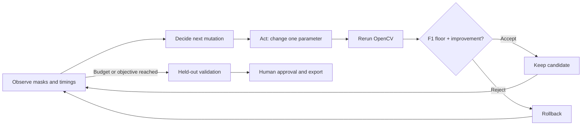

# COOLForge

**Make OpenCV faster without breaking what it sees.**

COOLForge is a closed-loop performance agent for OpenCV surface-inspection pipelines.
It profiles real image processing, tests concrete parameter changes against exact
defect masks, rolls back quality regressions, and asks a human to approve the final
configuration. The target runtime is OpenCV 5 with COOL on AWS Graviton.

**Project status:** the demo uses OpenCV 4.13. OpenCV 5/COOL on AWS Graviton is
the target deployment; verified cloud measurements are not yet available.
[Recorded local results](docs/assets/LOCAL_RESULTS.md) include synthetic quality scores,
latency measurements, and an agent trace.


## Why

A faster inspection pipeline is useful only while it still detects the defects that
matter. Resizing, blur, morphology, and threshold settings affect both latency and
the pixels seen as defects. COOLForge makes those tradeoffs observable and reviewable.

## What you can do

- **Inspect:** compare original surfaces, exact masks, predictions, bounding boxes, and stage timings.
- **Autotune:** run bounded, observation-driven search with a readable decision trace and rollback.
- **Review:** compare incumbent/proposed settings and held-out quality; approve a YAML export.
- **Benchmark:** launch separate stock/COOL interpreters and refuse incomparable evidence.
- **Reproduce:** regenerate seeded data, run tests, and deploy using a vendor-runtime-safe installer.

No model API key, database, or downloaded dataset is required. The agent is an explicit
heuristic policy, not an LLM wrapper. Its decisions are deterministic given observations;
real timing noise can alter its trajectory.

## Try it locally

Python 3.12 or newer is required. Clone the repository and create a virtual environment:

```bash
git clone https://github.com/Jeevang1-epic/COOLForge.git
cd COOLForge
python -m venv .venv
```

Activate the environment with `source .venv/bin/activate` on Linux/macOS or
`.\.venv\Scripts\Activate.ps1` in Windows PowerShell. Then install and launch:

```bash
python -m pip install -r requirements.txt
python -m streamlit run app.py --server.address 127.0.0.1
```

Open [localhost:8501](http://localhost:8501). Built-in samples are generated automatically;
no dataset download, credentials, or model API key is needed.

Start in **Inspect** to compare a surface with its exact defect mask. **Autotune Agent**
explores parameter changes and explains which candidates were accepted or rejected.
The final proposal includes held-out quality scores and a configuration download.
**Benchmarks** compares compatible measurement files, while **Architecture & Reproducibility**
explains the workload and reproduction commands.

The local demo uses headless OpenCV 4.13. For an existing OpenCV installation, use
`requirements-app.txt` instead. AWS COOL has its own [installation procedure](deploy/aws/README.md)
that preserves the vendor-provided OpenCV build.

## Host a demo on Streamlit Community Cloud

Community Cloud provides a shareable version of the inspection and tuning workbench.
It uses OpenCV 4.13; it is not a verified OpenCV 5/COOL or Graviton benchmark environment.

To host a personal copy, fork this repository and open
[Streamlit Community Cloud](https://share.streamlit.io/). Choose **Create app** and select
these settings for the fork:

| Setting | Value |
|---|---|
| Repository | `YOUR_GITHUB_USERNAME/COOLForge` |
| Branch | `main` |
| Main file path | `app.py` |
| Python version (Advanced settings) | `3.12` |
| Secrets | None |

Repository owners deploying the upstream project can use `Jeevang1-epic/COOLForge`.
The Repository field takes `owner/repository` **without `.git`**. Alternatively, **Paste
GitHub URL** accepts the entrypoint URL, such as
`https://github.com/Jeevang1-epic/COOLForge/blob/main/app.py`.
Select the exact `app.py` suggestion and verify the fields before clicking **Deploy**.

The root `requirements.txt` supplies pinned dependencies. Built-in data is generated
in memory, and the demo needs no external services. A small tuning subset is suitable
for shared hosting. Approved configurations and traces can be downloaded for later use;
session state is temporary.

### Deployment troubleshooting

| Symptom | Check |
|---|---|
| Repository does not exist | Use `owner/COOLForge`, without a `.git` suffix; confirm GitHub access to that repository. |
| Branch does not exist | Select `main` after the repository has been recognized. |
| Main file missing or an import error from an internal module | Select root `app.py`, not a file under `coolforge/`. |
| Private repository is not listed | Authorize the repository in the connected GitHub account; deployment requires admin access. |
| Red development-runtime message | Expected for the OpenCV 4.13 demo; inspection and tuning remain available. |
| No stock/COOL comparison | Upload compatible measurement artifacts; the demo does not ship with verified cloud results. |

For AWS installations, use `requirements-app.txt` through the COOL installer. The demo's
`requirements.txt` includes an OpenCV wheel and is not intended for the vendor environment.

Further reading: Streamlit's [deployment guide](https://docs.streamlit.io/deploy/streamlit-community-cloud/deploy-your-app/deploy)
and [repository access requirements](https://docs.streamlit.io/deploy/streamlit-community-cloud/status).

## Agent loop



Low recall in a candidate changes the next search branch toward sensitivity. False
positives prioritize threshold/area/morphology changes. Feasible quality permits testing
cheaper scales. Every candidate invokes the same OpenCV pipeline again. The audit trail
includes observations, rationale, effective configuration, outcome, failure, and acceptance.

## OpenCV workload and AWS architecture

The workload uses `resize`, `cvtColor`, `GaussianBlur`, `adaptiveThreshold`,
`morphologyEx`, `findContours`, `contourArea`, `boundingRect`, and drawing operations.
The target AWS path is browser → Nginx → localhost Streamlit → OpenCV 5 under `/opt/cool`
on an official Graviton COOL AMI. Benchmark workers run sequentially on the same host
using explicit interpreter paths. See [architecture diagrams and contracts](docs/ARCHITECTURE.md).

For AWS, follow [the deployment runbook](deploy/aws/README.md). Start with:

```bash
bash deploy/aws/install_on_cool_ami.sh
source /opt/cool/venvs/python_3.12/bin/activate
python scripts/verify_cool.py --json results/environment.json --require-cool
```

The installer never installs an OpenCV wheel. Verification requires OpenCV 5, Arm64,
the vendor installation root, loaded-module provenance, and affirmative backend markers.
This is conservative build verification, not proof of acceleration in every operation.

## Benchmark reproduction

Generate a reproducible dataset before running the command-line benchmarks:

```bash
python scripts/generate_dataset.py --output data/eval --count 50 --seed 42
python scripts/evaluate.py --dataset data/eval
```

An existing dataset can be reused; generation does not overwrite its manifest.

```bash
# A real local measurement, never labeled a stock OpenCV 5 baseline:
python scripts/benchmark_worker.py --name local --dataset data/eval --warmups 5 --iterations 30 --output results/local.json
# On Graviton, after preparing a separate stock OpenCV 5 interpreter:
python scripts/benchmark_matrix.py --stock-python /path/to/stock/python --cool-python /opt/cool/venvs/python_3.12/bin/python --dataset data/eval --warmups 5 --iterations 30
```

Replace the stock path with an actual environment. Both inputs must share source/data
hashes, configuration, host, thread settings, budgets, and runtime versions. Missing or
mismatched inputs produce a reason, not a ratio. Read [BENCHMARKS.md](BENCHMARKS.md)
before interpreting latency or throughput.

## Development and tests

Install the development tools in the same virtual environment:

```bash
python -m pip install -r requirements-dev.txt
python -m pytest -q
python -m ruff check .
python -m ruff format --check .
```

Tests cover mask edge cases, configuration validation, deterministic data, failed
OpenCV calls, adaptive policy decisions, rollback, verification false positives,
benchmark provenance, CLI subprocesses, and Streamlit interactions. CI uses local
development OpenCV on Python 3.12 and 3.14; it does not certify COOL.

| Path | Purpose |
|---|---|
| `coolforge/` | Typed core pipeline, metrics, agent, environment, benchmark contracts |
| `coolforge/ui/`, `app.py` | Four-tab Streamlit workbench |
| `scripts/` | Reproducible command-line entry points |
| `configs/` | Reviewed starting configuration |
| `tests/` | Core, policy, CLI, and app regression tests |
| `deploy/` | COOL installer, systemd unit, Nginx config |
| `docs/assets/` | Real local measurements, synthetic examples, screenshots |
| `REPORT.md` | Technical submission report and verification gaps |

## Limitations and responsible use

Synthetic dark defects are not representative of every material or camera. Downsampling
can erase thin cracks; texture and lighting can create false positives. Global pixel F1
can hide poor performance on rare small defects. Use representative held-out production
data before deployment. This prototype is not certified industrial quality control.

The core sends no image to an external AI service. Public demos should use nonsensitive
images, restricted access, and appropriate transport protection. Export requires human
action and does not deploy a workload. See [responsible use](docs/RESPONSIBLE_USE.md).

## Roadmap

- Verified OpenCV 5/COOL execution and repeated stock/COOL comparisons on Graviton.
- Evaluation on real labeled surfaces, including rare and small defects.
- Optional MCP adapters for the tested inspection and optimization tools.

## Contributing and license

See [CONTRIBUTING.md](CONTRIBUTING.md). Code and generated synthetic examples are
licensed under [Apache-2.0](LICENSE). Bug reports, reproducible benchmark results, and
improvements to the inspection workflow are welcome.
