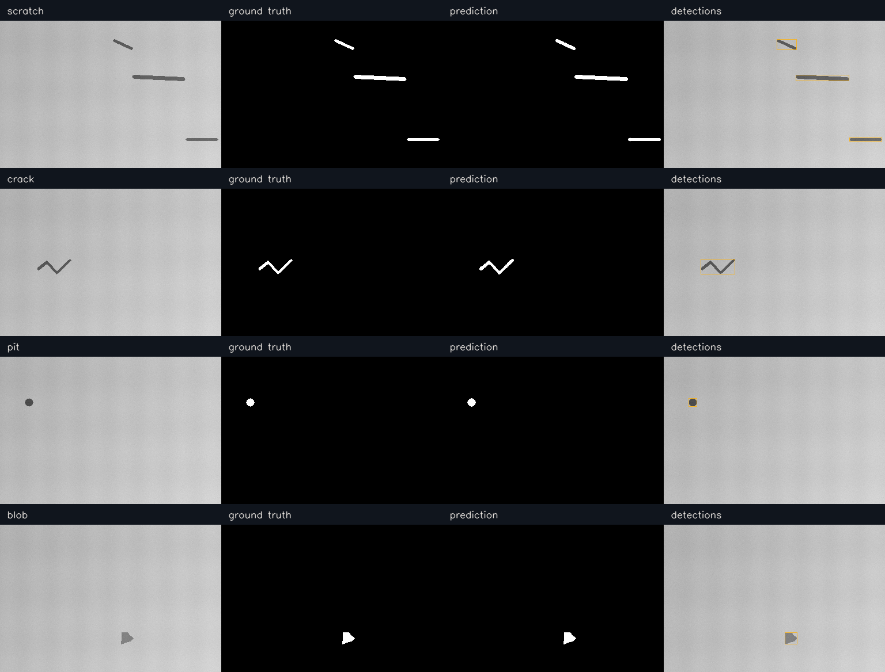
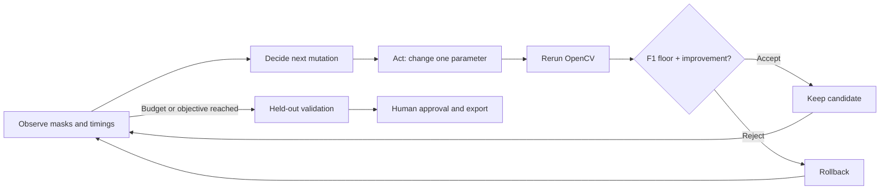

# COOLForge

**Make OpenCV faster without breaking what it sees.**

COOLForge is a closed-loop performance agent for OpenCV surface-inspection pipelines.
It profiles real image processing, tests concrete parameter changes against exact
defect masks, rolls back quality regressions, and asks a human to approve the final
configuration. The target runtime is OpenCV 5 with COOL on AWS Graviton.

**Evidence status:** the checked-in demonstration runs on local OpenCV 4.13, not COOL.
OpenCV 5/COOL verification, AWS execution, and a matched stock/COOL comparison remain
operator steps. There is no claimed cloud speedup. See the actual
[local measurements and trace](docs/assets/LOCAL_RESULTS.md).



## Why

A faster inspection pipeline is useful only while it still detects the defects that
matter. Resizing, blur, morphology, and threshold settings affect both latency and
the pixels seen as defects. COOLForge makes those tradeoffs observable and reviewable.

## What you can do

- **Inspect:** compare original surfaces, exact masks, predictions, bounding boxes, and stage timings.
- **Autotune:** run bounded, observation-driven search with a readable decision trace and rollback.
- **Review:** compare incumbent/proposed settings and held-out quality; approve a YAML export.
- **Benchmark:** launch separate stock/COOL interpreters and refuse incomparable evidence.
- **Reproduce:** regenerate seeded data, run tests, and deploy using a vendor-runtime-safe installer.

No model API key, database, or downloaded dataset is required. The agent is an explicit
heuristic policy, not an LLM wrapper. Its decisions are deterministic given observations;
real timing noise can alter its trajectory.

## Quickstart

Use Python 3.12 or newer. In a **new local environment**:

```bash
python -m venv .venv
# Linux/macOS:
source .venv/bin/activate
# Windows PowerShell instead:
# .\.venv\Scripts\Activate.ps1
python -m pip install -r requirements-dev.txt
python -m pip install -e '.[local]'
python scripts/generate_dataset.py --output data/eval --count 50
python scripts/evaluate.py --dataset data/eval
python scripts/autotune.py --dataset data/eval --max-iterations 12
python scripts/verify_cool.py --json results/environment.json
python -m pytest -q
python -m streamlit run app.py
```

The `local` extra deliberately installs a pinned OpenCV 4.13 development wheel. It is
**not competition-compliant**. If you already have a suitable `cv2`, install application
requirements and use `python -m pip install --no-deps -e .` instead. Never use `.[local]`
on the COOL AMI. Dataset generation refuses to overwrite an existing manifest; reuse
the dataset or select another output directory. The app also generates a built-in set
in memory and can start without running the dataset CLI first.

Open [localhost:8501](http://localhost:8501). For the shortest interactive test, inspect
`0001_scratch`, run Autotune on 15 samples, and read both accepted and rejected rows.
The red/amber/green environment card always reflects the runtime checks.

## Agent loop



Low recall in a candidate changes the next search branch toward sensitivity. False
positives prioritize threshold/area/morphology changes. Feasible quality permits testing
cheaper scales. Every candidate invokes the same OpenCV pipeline again. The audit trail
includes observations, rationale, effective configuration, outcome, failure, and acceptance.

## OpenCV workload and AWS architecture

The workload uses `resize`, `cvtColor`, `GaussianBlur`, `adaptiveThreshold`,
`morphologyEx`, `findContours`, `contourArea`, `boundingRect`, and drawing operations.
The target AWS path is browser → Nginx → localhost Streamlit → OpenCV 5 under `/opt/cool`
on an official Graviton COOL AMI. Benchmark workers run sequentially on the same host
using explicit interpreter paths. See [architecture diagrams and contracts](docs/ARCHITECTURE.md).

For AWS, follow [the deployment runbook](deploy/aws/README.md). Start with:

```bash
bash deploy/aws/install_on_cool_ami.sh
source /opt/cool/venvs/python_3.12/bin/activate
python scripts/verify_cool.py --json results/environment.json --require-cool
```

The installer never installs an OpenCV wheel. Verification requires OpenCV 5, Arm64,
the vendor installation root, loaded-module provenance, and affirmative backend markers.
This is conservative build verification, not proof of acceleration in every operation.

## Benchmark reproduction

```bash
# A real local measurement, never labeled a stock OpenCV 5 baseline:
python scripts/benchmark_worker.py --name local --dataset data/eval --warmups 5 --iterations 30 --output results/local.json
# On Graviton, after preparing a separate stock OpenCV 5 interpreter:
python scripts/benchmark_matrix.py --stock-python /path/to/stock/python --cool-python /opt/cool/venvs/python_3.12/bin/python --dataset data/eval --warmups 5 --iterations 30
```

Replace the stock path with an actual environment. Both inputs must share source/data
hashes, configuration, host, thread settings, budgets, and runtime versions. Missing or
mismatched inputs produce a reason, not a ratio. Read [BENCHMARKS.md](BENCHMARKS.md)
before interpreting latency or throughput.

## Tests and project map

```bash
python -m pytest -q
python -m ruff check .
python -m ruff format --check .
```

Tests cover mask edge cases, configuration validation, deterministic data, failed
OpenCV calls, adaptive policy decisions, rollback, verification false positives,
benchmark provenance, CLI subprocesses, and Streamlit interactions. CI uses local
development OpenCV on Python 3.12 and 3.14; it does not certify COOL.

| Path | Purpose |
|---|---|
| `coolforge/` | Typed core pipeline, metrics, agent, environment, benchmark contracts |
| `coolforge/ui/`, `app.py` | Four-tab Streamlit workbench |
| `scripts/` | Reproducible command-line entry points |
| `configs/` | Reviewed starting configuration |
| `tests/` | Core, policy, CLI, and app regression tests |
| `deploy/` | COOL installer, systemd unit, Nginx config |
| `docs/assets/` | Real local measurements, synthetic examples, screenshots |
| `REPORT.md` | Technical submission report and verification gaps |

## Limitations and responsible use

Synthetic dark defects are not representative of every material or camera. Downsampling
can erase thin cracks; texture and lighting can create false positives. Global pixel F1
can hide poor performance on rare small defects. Use representative held-out production
data before deployment. This prototype is not certified industrial quality control.

The core sends no image to an external AI service. Public demos should use nonsensitive
images, restricted access, and appropriate transport protection. Export requires human
action and does not deploy a workload. See [responsible use](docs/RESPONSIBLE_USE.md).

## Next evidence milestones

1. Run the supplied workload and strict verifier on OpenCV 5/COOL on Graviton.
2. Record repeated matched stock/COOL pairs and report quality parity and uncertainty.
3. Evaluate real labeled surfaces and per-defect failure rates.
4. Consider optional MCP adapters only after the core evidence is complete.

## Contributing and license

See [CONTRIBUTING.md](CONTRIBUTING.md). Code and generated synthetic examples are
licensed under [Apache-2.0](LICENSE). Suggested repository topics: `opencv`, `computer-vision`,
`aws-graviton`, `performance`, `visual-inspection`, `streamlit`, `agentic-vision`.
