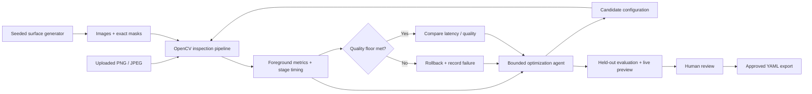
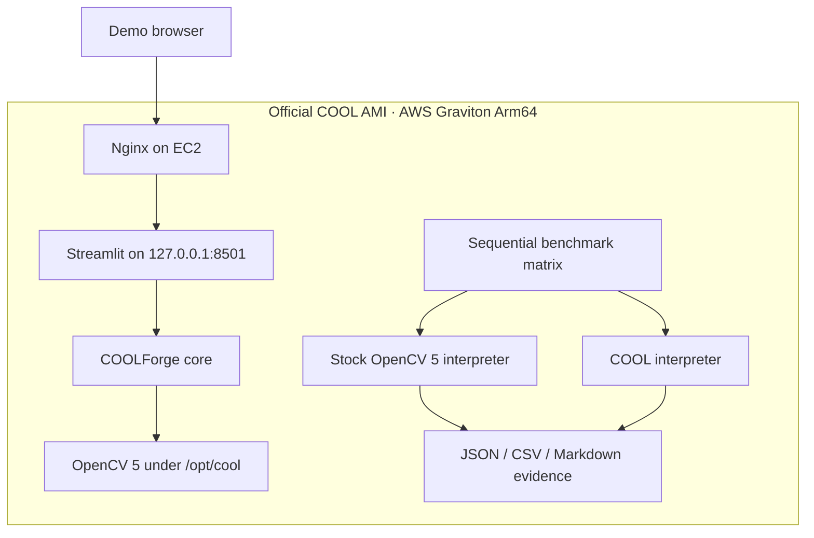

# Architecture

COOLForge separates measurement, policy, and human approval. The same Python functions
execute under a local OpenCV build or the vendor COOL environment; no alternate fake
implementation is selected when acceleration is absent.

## Contracts

| Module | Responsibility | Failure boundary |
|---|---|---|
| `config` | Frozen validated pipeline parameters; safe YAML | Reject unknown keys, NaN, invalid kernels |
| `dataset` | Seeded surfaces, masks, manifests, SHA-256 | Reject corrupt masks, path traversal, hash mismatch |
| `pipeline` | OpenCV transforms, mask, boxes, annotation, timing | Convert OpenCV exceptions to `PipelineError` |
| `metrics` | Foreground counts and latency distributions | Explicit empty-mask semantics |
| `evaluation` | Repeated evaluation and micro/macro aggregation | A failed sample invalidates the whole candidate |
| `agent` | Observation-dependent mutations and rollback | Hard iteration cap; incumbent retained on failure |
| `environment` | Corroborated runtime evidence | Unknown/weak evidence never turns green |
| `benchmark` | Measurements, schema checks, fair comparison | Incomparable or missing inputs suppress ratio |
| `ui` | Inspection, trace review, export, evidence | Per-file errors shown without terminating app |

## Pipeline and coordinate systems

Input is uint8 BGR. Resize uses `INTER_AREA`; grayscale conversion precedes Gaussian
blur and adaptive Gaussian inverse thresholding. An elliptical opening removes noise.
External contours are filtered using a minimum area expressed in original-image pixels,
scaled by actual resized width × height. The retained mask is intersected with threshold
pixels to preserve holes, then returned to original resolution with nearest-neighbor
interpolation. Full-resolution contours supply bounding boxes and annotation.

The seven stage clocks use `perf_counter_ns`. Total latency includes array allocation,
contour bookkeeping, and annotation. It excludes disk loading, quality scoring, dataset
generation, JSON serialization, and Streamlit rendering. Throughput is the reciprocal
of mean single-image pipeline latency, not concurrent server throughput.

## Policy and invariants

The policy first considers a preceding candidate's recall failure, then incumbent
precision, then feasibility, then cheaper settings. It changes one coordinate at a
time, never retries the same configuration, and records its inputs, action, rationale,
result, acceptance, and failure. A candidate below the F1 floor is never accepted.
Among feasible configurations, acceptance needs at least 3% lower p50 latency, or a
quality increase above 0.005 with at most 2% latency cost. The feasible Pareto frontier
is retained in the audit record.

The default evaluator warms each image once and measures three passes. The policy is
deterministic **given observations**; real wall-clock timing may change its trajectory.
There is no guarantee of global optimality. An infeasible start may remain stuck if
recovery requires several individually infeasible steps; lowering the floor or selecting
a better initial configuration must be an explicit operator decision.

The UI evaluates the selected proposal on a separate seed before allowing export and
reruns it for a live preview. Editing controls invalidates the export review. Neither
the CLI trace nor the UI silently writes over a user's configuration.

## Runtime evidence

`cool_verified` requires all five checks: OpenCV 5, Arm64, `/opt/cool` existence, `cv2`
loaded from that root, and affirmative custom backend build markers. A generic SVE/NEON
mention alone is insufficient. This proves a conservative build-provenance condition,
not kernel dispatch for each call or AWS hosting. Record AMI/instance evidence separately.

No database, external model API, or required MCP service exists. Optional MCP wrappers
are deferred until the core has measured OpenCV 5/COOL evidence.
